# Zümrüt — ikas Studio teması · kullanım rehberi

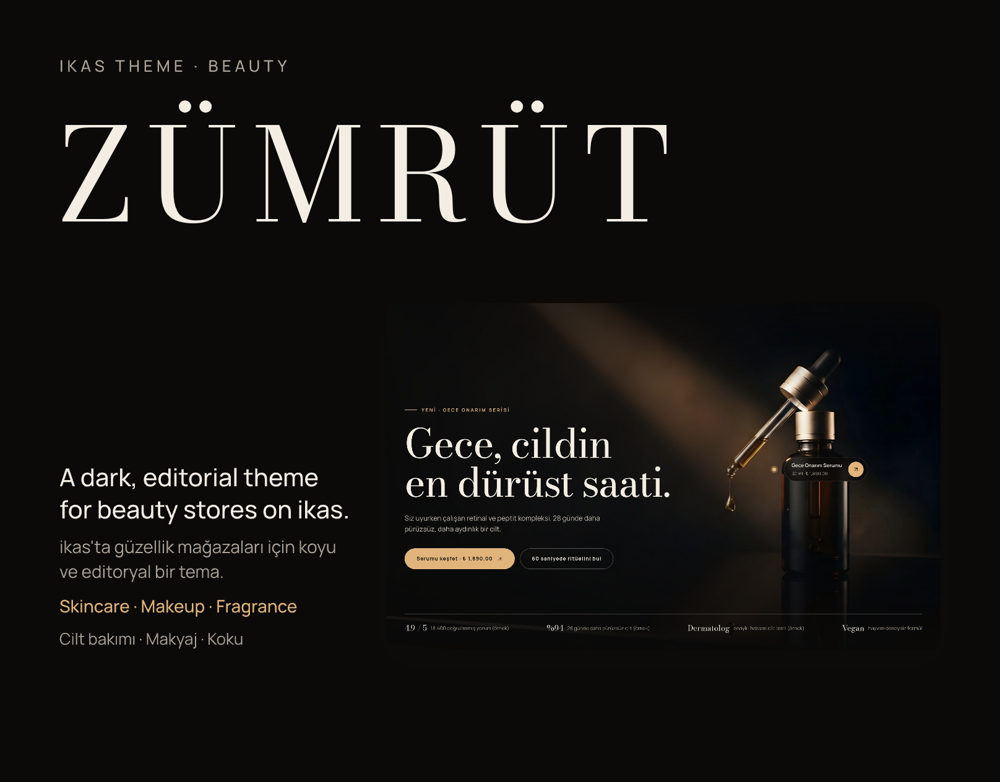

Zümrüt, cilt bakımı, makyaj ve koku mağazaları için koyu ve editoryal bir ikas temasıdır. Bu rehber temayı kurmayı ve her bölümün ayarını editörde ya da panelde nerede bulacağınızı adım adım anlatır.
*A dark, editorial ikas theme for skincare, makeup and fragrance stores. This guide shows how to set it up and where every setting lives.*

**Canlı önizleme / Live preview:** https://dev-mustafa1.ikas.shop

> Editördeki yollar `Sayfa › Bölüm › Ayar grubu › Alan` biçiminde yazılmıştır. Örnek: `Anasayfa › Hero › İçerik › Üst etiket`.
> *Editor paths read Page › Section › Group › Field.*

---

## İçindekiler

**Kurulum**
1. [Başlarken](#1-başlarken--getting-started)
2. [Header](#2-header)
3. [Footer](#3-footer)

**Sayfalar**

4. [Ana sayfa](#4-ana-sayfa--home-page)
5. [Kategori sayfası](#5-kategori-sayfası--category-page)
6. [Ürün sayfası](#6-ürün-sayfası--product-page)
7. [Sepet ve satışı artıran kurgular](#7-sepet-ve-satışı-artıran-kurgular--cart-growth)
8. [Kurumsal sayfalar](#8-kurumsal-sayfalar--content-pages)
9. [Üyelik ve hesap sayfaları](#9-üyelik-ve-hesap-sayfaları--account-pages)

**Öne çıkan özellikler**

10. [Cilt testi](#10-cilt-testi--skin-quiz)
11. [Ritüel bulucu](#11-ritüel-bulucu--ritual-finder)
12. [Cilt haritası, ton bulucu, gerçek yüzler](#12-cilt-haritası-ton-bulucu-gerçek-yüzler--interactive-sections)

**Ayarlar**

13. [Panelde girilen bilgiler](#13-panelde-girilen-bilgiler--panel-to-site)
14. [Renk şemaları ve tasarım sistemi](#14-renk-şemaları-ve-tasarım-sistemi--color-and-design)
15. [Görsel oranı, kırpma ve metin konumu](#15-görsel-oranı-kırpma-ve-metin-konumu--image-settings)
16. [Mobil](#16-mobil--mobile)
17. [Sık karşılaşılan durumlar](#17-sık-karşılaşılan-durumlar--troubleshooting)

---

## 1. Başlarken · Getting started

Temayı satış kanalınıza kurduktan sonra şu dört adımla mağazanız kullanıma hazır olur.
*Four steps after installing the theme.*

| Adım | Ne yapılır | Editörde nereden açılır |
|---|---|---|
| 1 | Renk şemasını seçin. Varsayılan şema Gece'dir. | `Header › Renk Şeması ve Açık / Koyu › Site renk şeması` |
| 2 | Logoyu ve menüyü girin. | `Header › Logo`, `Header › Menü` |
| 3 | Duyuru çubuğunu yazın (ör. ücretsiz kargo sınırı). | `Header › Duyuru Çubuğu` |
| 4 | Footer'da bülten metnini, bağlantı sütunlarını, sosyal medya ve ödeme logolarını düzenleyin. | `Footer` |

Editörde her alanın altında o alanın ne işe yaradığını anlatan kısa bir açıklama bulunur. Sitedeki her metin, görsel, bağlantı ve renk buradan değişir; kod yazmanız gerekmez.
*Every field has a short description under it. Every text, image, link and color is editable without code.*

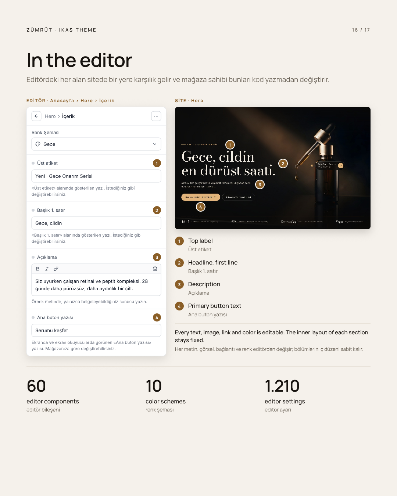

| # | Editörde (`Anasayfa › Hero › İçerik`) | Sitede |
|---|---|---|
| 1 | Üst etiket | Başlığın üstündeki üst etiket |
| 2 | Başlık 1. satır | Başlığın ilk satırı |
| 3 | Açıklama | Başlığın altındaki açıklama |
| 4 | Ana buton yazısı | Ana butonun yazısı |

---

## 2. Header

Header her sayfada görünür; duyuru çubuğu, menü, arama, açık / koyu düğmesi, favoriler ve yan sepet buradan yönetilir.
*The header appears on every page and holds the announcement bar, menu, search, theme switch, favorites and cart drawer.*

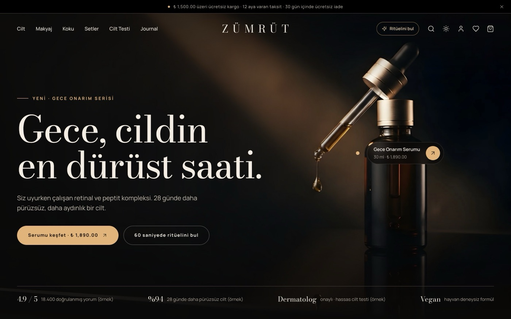

| Ayar grubu | Neyi değiştirir |
|---|---|
| Duyuru Çubuğu | Üstteki duyuru metni ve bağlantısı; ziyaretçi kapatabilsin mi |
| Logo | Yazı ya da görsel logo; masaüstü ve telefon için ayrı logo yüksekliği |
| Menü | Ana menü bağlantıları, telefona özel ek bağlantılar, mobil menüde dil ve para birimi seçici |
| Kısayollar | "Ritüelini bul" gibi öne çıkan bağlantı düğmesi; favoriler ikonu |
| Arama | Arama kutusu, popüler aramalar, sonuçsuz arama metinleri, aramada önerilecek ürün listesi |
| Sepet Çekmecesi | Yan sepetin metinleri, ücretsiz kargo çubuğu ve boş sepet ekranı |
| Mobil Alt Çubuk | Telefondaki alt sekme çubuğu (16. başlık) |
| Renk Şeması ve Açık / Koyu | Sitenin şeması ve ziyaretçi açık / koyu düğmesi (14. başlık) |
| Görünüm | Header arka planı, sayfa geçişinde yükleme çizgisi, buton köşe yuvarlaklığı ve üzerine gelme parlaklığı |

---

## 3. Footer

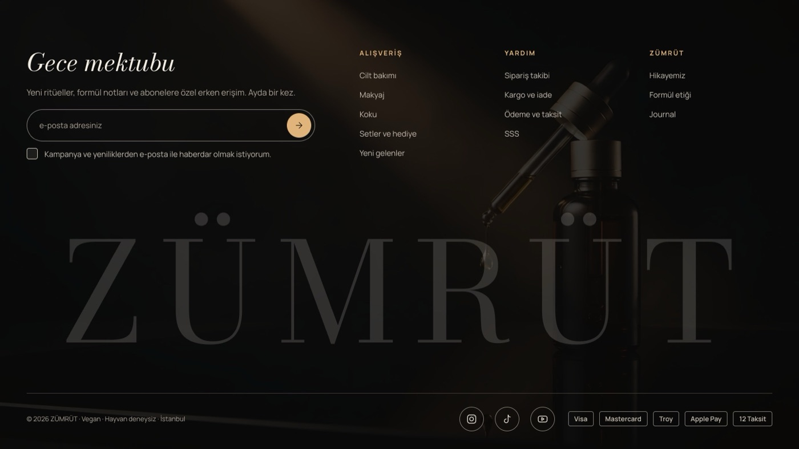

| Ayar grubu | Neyi değiştirir |
|---|---|
| Bülten | Bülten başlığı, açıklaması, e-posta alanı ve izin kutusu |
| Bağlantı Sütunları | Sütun başlıkları ve bağlantıları (sütun ekleyip sıralayabilirsiniz) |
| Marka | Büyük marka yazısı ya da logo görseli |
| Alt Satır | Telif satırı, sosyal medya hesapları, ödeme yöntemi logoları, dil ve para birimi seçici |
| Görünüm | Arka plan rengi, arka plan görseli ve görsel karartma oranı |

Sosyal medya ve ödeme yöntemleri liste olarak eklenir; kendi ikonunuzu ya da logonuzu yükleyebilirsiniz.
*Social links and payment logos are lists; you can upload your own icons.*

---

## 4. Ana sayfa · Home page

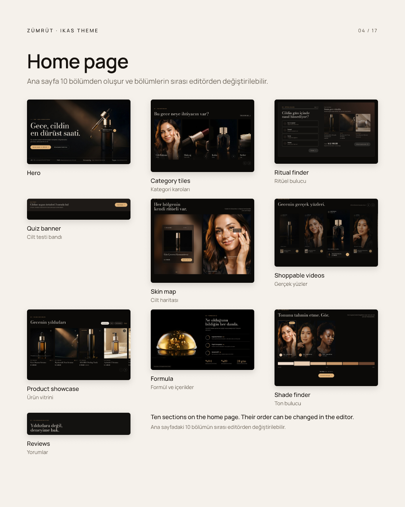

Ana sayfada 10 bölüm vardır. Bölümlerin sırası editörde sürükleyerek değişir, istemediğiniz bölümü kaldırabilir, aynı bölümü başka sayfalara da ekleyebilirsiniz.
*Ten sections; drag to reorder, remove or reuse them on other pages.*

| Bölüm (editördeki adı) | Ne gösterir | Önemli ayar grupları |
|---|---|---|
| Hero | Büyük görsel, başlık, iki buton, öne çıkan ürün noktası | İçerik, Görsel ve Video, Ürün Noktası, Kanıt Satırı, Görsel Örtüsü |
| Kategori karoları (CategoryTiles) | Kategori kutuları | İçerik › Kutular, Kaydırma (Slider) |
| Ritüel bulucu (RitualFinder) | Üç adımlı gece rutini | Sorular (11. başlık) |
| Cilt testi bandı (PromoBanner) | Cilt testine çağıran bant | İçerik, Geri Sayım, Buton |
| Cilt haritası (SkinMap) | Yüz bölgesine göre ürün | Bölgeler (12. başlık) |
| Gerçek yüzler (ShoppableVideos) | Satın alınabilir müşteri videoları | Videolar (12. başlık) |
| Ürün vitrini (ProductShowcase) | Sekmeli ürün listesi | Sekmeler, Ürün Kartı |
| Formül ve içerikler (Science) | Öne çıkan içerikler ve sonuç rakamları | İçerikler, Sonuçlar |
| Ton bulucu (ShadeFinder) | Tona göre model ve ürün seçeneği | Veri, Modeller (12. başlık) |
| Yorumlar (ReviewShowcase) | Seçilen ürünlerin müşteri yorumları | Veri › Yorumları gösterilecek ürünler |

### 4.1 Hero

Hero, sayfanın ilk ekranıdır; görsel ya da video, başlık, iki buton ve bir ürüne işaret eden nokta içerir.
*The first screen: image or video, headline, two buttons and a product hotspot.*

| Ayar grubu | Neyi değiştirir |
|---|---|
| İçerik | Üst etiket, iki satır başlık, açıklama, iki buton; metin konumu masaüstü ve telefon için ayrı seçilir |
| Görsel ve Video | Masaüstü ve telefon için ayrı arka plan görseli, isteğe bağlı arka plan videosu |
| Ürün Noktası | Görseldeki ürün noktası, noktanın yatay ve dikey yeri, ana butonda ürün fiyatı |
| Kanıt Satırı | Alttaki "4.9 / 5", "%94" gibi kanıt maddeleri; masaüstü ve telefonda slider |
| Görsel Örtüsü | Yazının okunması için görselin üstüne binen gölgenin rengi, yoğunluğu ve genişliği |
| Görünüm | Bölüm yüksekliği (masaüstü ve telefon ayrı) |

### 4.2 Kategori karoları · Category tiles

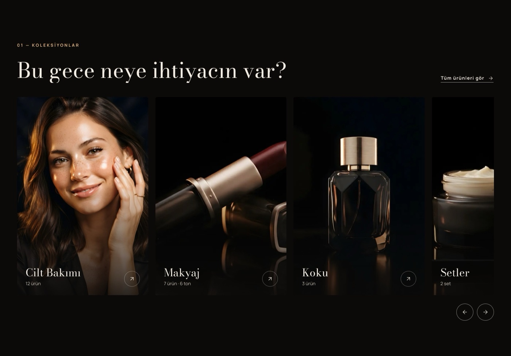

Her kutuya bir kategori, görsel ve bağlantı verilir. Kutular masaüstünde ve telefonda kaydırmalı (slider) gösterilebilir; görünür kutu adedi ayrı ayrı seçilir.
*Each tile has a category, image and link; slider and visible count are set per device.*

### 4.3 Cilt testi bandı · Promo banner

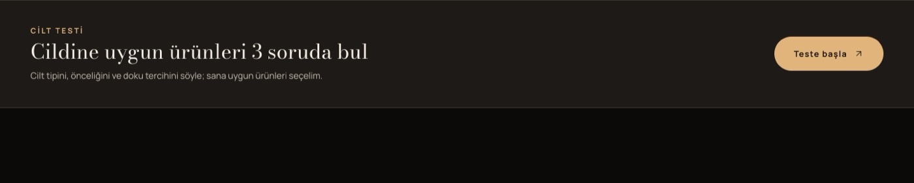

Bant herhangi bir sayfaya ya da kampanyaya yönlendirebilir. **Geri Sayım** grubunda bitiş tarihi girilirse bant geri sayım gösterir; boş bırakılırsa geri sayım çıkmaz.
*Links anywhere; add an end date to show a countdown.*

### 4.4 Ürün vitrini · Product showcase

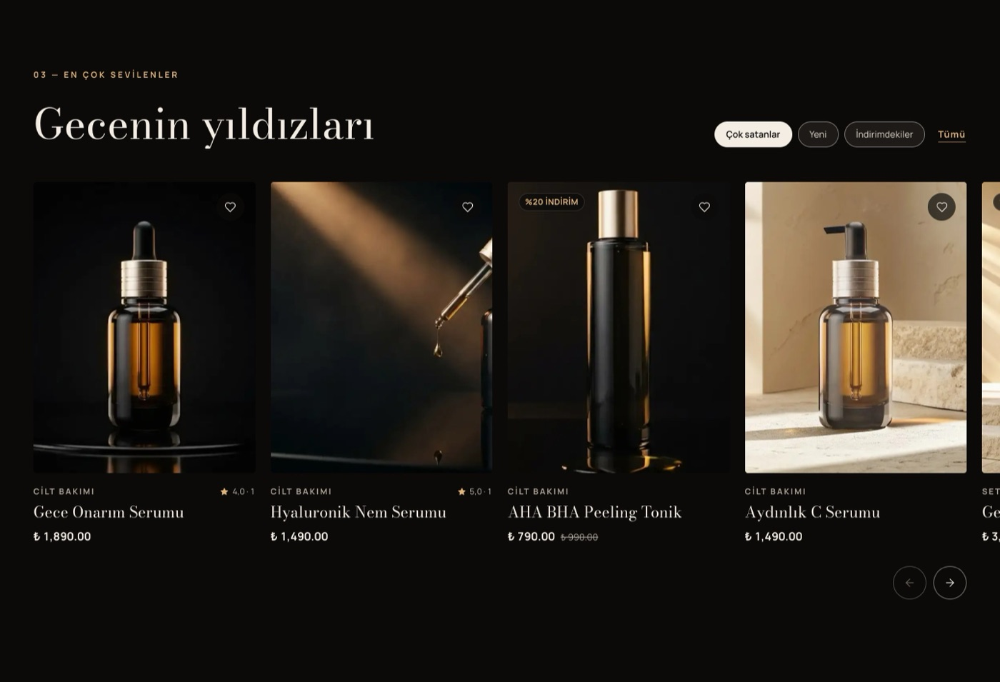

**Sekmeler** listesine her sekme için bir ad ve ürün listesi eklenir (ör. Çok satanlar, Yeni gelenler). Tek sekme varsa sekme çubuğu gizlenir. **Ürün Kartı** grubunda kart üzerindeki badge'ler ve hızlı ekle düğmesi açılıp kapatılır.
*Add a name and product list per tab; card badges and quick add can be turned off.*

### 4.5 Formül ve içerikler · Formula

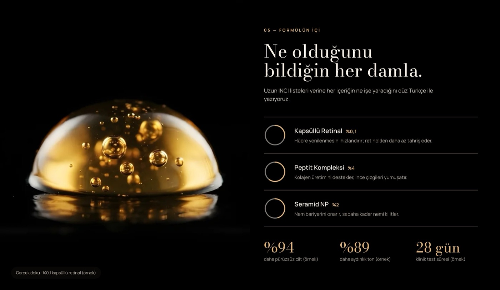

**İçerikler** listesine öne çıkan içerikler, **Sonuçlar** listesine yüzde ve süre gibi rakamlar eklenir. Rakamlar sayfa göründüğünde sayarak açılır.
*Add key ingredients and result figures; figures count up on scroll.*

### 4.6 Yorumlar · Reviews

`Veri › Yorumları gösterilecek ürünler` alanında seçilen ürünlerin onaylı yorumları listelenir; **En fazla yorum** ile kaç yorumun gösterileceği belirlenir.
*Shows approved reviews of the selected products.*

---

## 5. Kategori sayfası · Category page

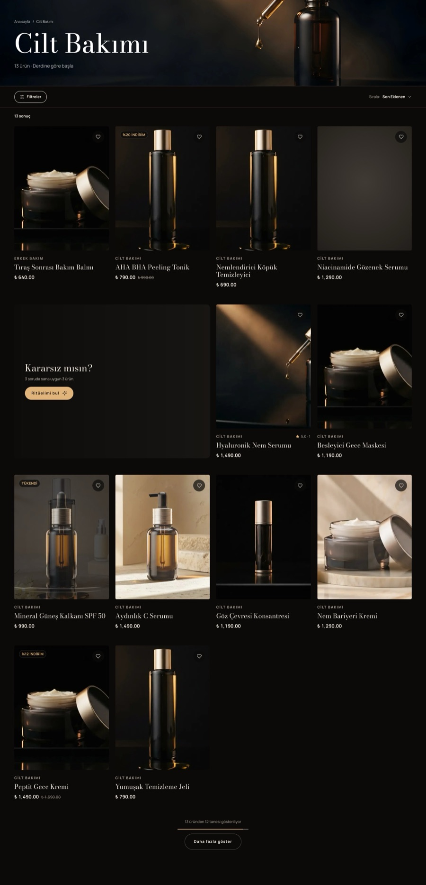

Kategori, marka ve arama sonuç sayfaları aynı bölümü (ProductList) kullanır.
*Category, brand and search pages share one section.*

| Ayar grubu | Neyi değiştirir |
|---|---|
| Üst Alan | Görselli üst alan, başlık, alt başlık ve hızlı filtre |
| Filtre ve Sıralama | Filtre paneli ve tema için tasarlanmış sıralama menüsü |
| Tanıtım Kartı | Ürünlerin arasına giren kart (ör. "Kararsız mısın? Cilt testine git"); kaçıncı üründen sonra çıkacağı |
| Daha Fazla Yükle | Sayfada gösterilen ürün sayısı; "daha fazla göster" ya da sonsuz kaydırma |
| Ürün Kartı | Kart üzerindeki badge'ler, hızlı ekle ve hızlı bakış |
| Görünüm | Masaüstü ve telefon için sütun adedi |

---

## 6. Ürün sayfası · Product page

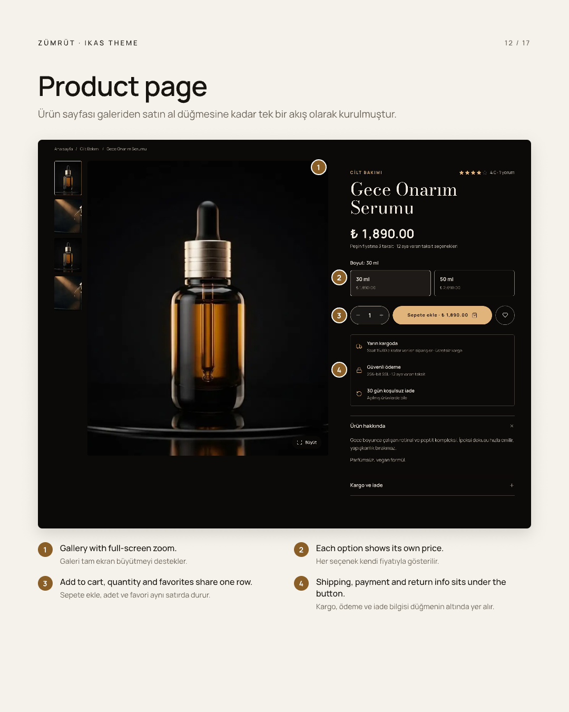

| # | Özellik | Nereden açılır |
|---|---|---|
| 1 | Galeri tam ekran büyütmeyi destekler. | `Ürün Sayfası › ProductDetail › Galeri` |
| 2 | Her seçenek kendi fiyatıyla gösterilir. | Seçenekler ve fiyatlar panelde ürünün varyantından gelir. |
| 3 | Sepete ekle, adet ve favori aynı satırda durur. | `ProductDetail › Satın Alma` |
| 4 | Kargo, ödeme ve iade bilgisi düğmenin altında yer alır. | `ProductDetail › Güven Satırları` |

| Ayar grubu | Neyi değiştirir |
|---|---|
| Ürün Bilgisi | Marka, SKU ve favori düğmesinin gösterilip gösterilmeyeceği |
| Stok Bildirimi | Stokta olmayan üründe "gelince haber ver" formu |
| Açılır Bilgiler | "Ürün hakkında", "Kargo ve iade" gibi açılır bölümler |
| Kişiselleştirme ve Set | Kişiselleştirme alanları (yazı, seçim, renk, tarih, dosya) ve set içeriği |

### Set ürünleri · Bundles

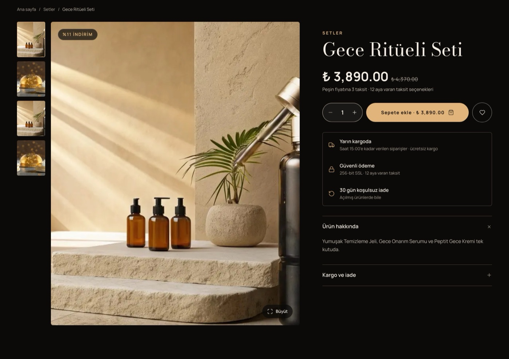

Set ürünlerinde setin içindeki ürünler sayfada listelenir ve set tek düğmeyle sepete eklenir.
*Bundle pages list the items inside and add the whole set at once.*

Ürün sayfasının altına **Ritüeli tamamla** (CompleteRitual) ve **Nasıl kullanılır** (ProductHowTo) bölümleri eklenebilir. Ritüeli tamamla, tamamlayıcı ürünleri önerir.
*"Complete the ritual" and "How to use" can be added under the product.*

---

## 7. Sepet ve satışı artıran kurgular · Cart growth

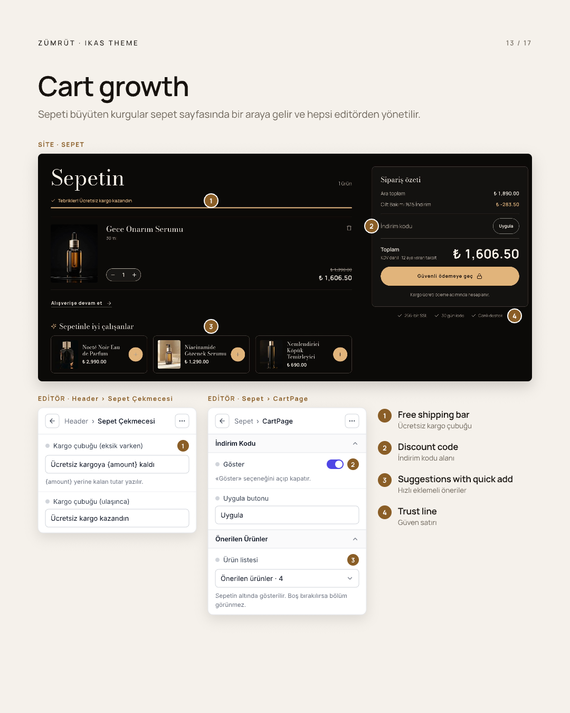

| # | Kurgu | Nereden açılır |
|---|---|---|
| 1 | Ücretsiz kargo çubuğu | Metinler: `Header › Sepet Çekmecesi`. Sınır mağazanın kampanyasından gelir: `Panel › İndirimler › Kampanyalar`. |
| 2 | İndirim kodu alanı | `Sepet › CartPage › İndirim Kodu › Göster` |
| 3 | Hızlı eklemeli öneriler | `Sepet › CartPage › Önerilen Ürünler › Ürün listesi` (boşsa bölüm görünmez) |
| 4 | Güven satırı | `Sepet › CartPage › Sipariş Özeti › Güven notları` |

Kampanya indirimi sipariş özetinde ayrı bir satır olarak görünür. Cilt testi sonucu, ritüel bulucu, gerçek yüzler videoları, setler ve "Ritüeli tamamla" da sepete doğrudan ürün ekler.
*Campaign discounts show as a line in the order summary; several sections add to cart directly.*

---

## 8. Kurumsal sayfalar · Content pages

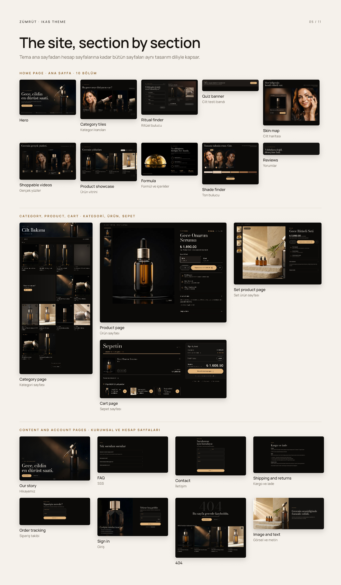

| Sayfa | Bölüm | Neyi değiştirir |
|---|---|---|
| SSS | Faq | Soru ve cevap listesi |
| İletişim | ContactForm | Başlık, açıklama, telefon alanı |
| Sipariş takibi | OrderTracking | Form ve sonuç ekranının metinleri |
| Hikayemiz | HeroSlider, ImageText, RichText | Slayt, görsel ve metin blokları |
| Kargo ve iade | RichText | Metin sayfası |
| 404 | NotFound | Metinler ve önerilen ürünler |

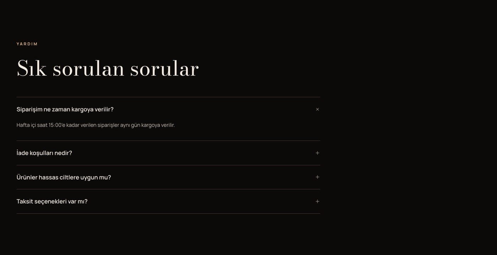
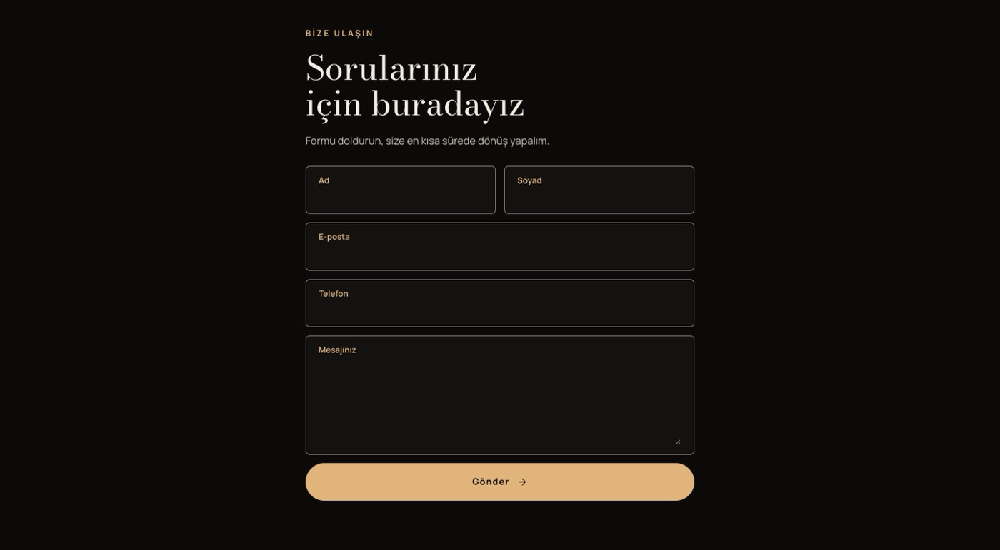

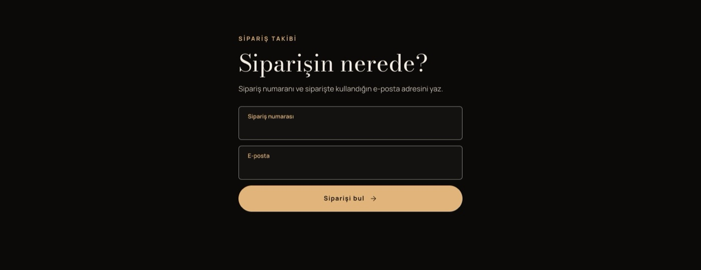

Görsel ve metin (ImageText), zengin metin (RichText) ve güven rozetleri (TrustBadges) bölümleri her sayfaya eklenebilir.
*Image + text, rich text and trust badges can be added to any page.*

---

## 9. Üyelik ve hesap sayfaları · Account pages

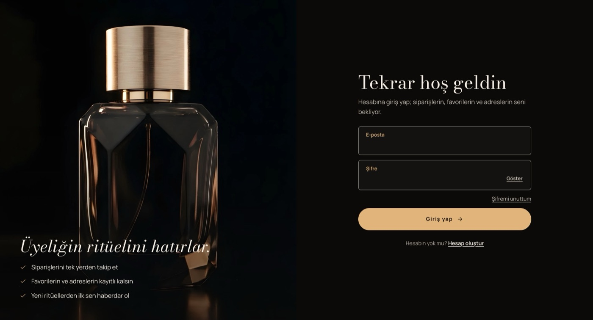

| Sayfa | Bölüm | Neyi değiştirir |
|---|---|---|
| Giriş | Login | Yan görsel ve avantaj maddeleri, Google / Facebook ile giriş |
| Kayıt | Register | Form alanları (telefon, şifre tekrar), üyelik sözleşmesi penceresi, pazarlama izni |
| Şifremi unuttum, şifre sıfırlama, e-posta doğrulama | ForgotPassword, RecoverPassword, EmailVerification | Metinler ve yan görsel |
| Hesap bilgileri | AccountInfo | Özet ve hesap bilgileri; paneldeki müşteri özel alanları burada düzenlenir |
| Siparişler ve sipariş detayı | AccountOrders, AccountOrderDetail | Sipariş listesi, kargo takip bağlantısı, iade talebi |
| Adresler, favoriler | AccountAddresses, AccountFavorites | Adres kartı ve formu, favori ürünler |

**İade talebi:** Sipariş detayında müşteri ürünü ve adedini seçer, iade nedenini ve açıklamasını yazar. İade nedenleri ve iade süresi paneldeki iade ayarlarından gelir.
*Customers pick items and quantity, then a reason and a note; reasons come from the panel's return settings.*

---

## 10. Cilt testi · Skin quiz

Cilt testi, alıcıya üç soru sorar ve cevaplara uyan ürünleri mağazanın kendi ürün bilgisinden seçer. Elle ürün listesi tutmanız gerekmez.
*Three questions pick matching products from your own product data.*

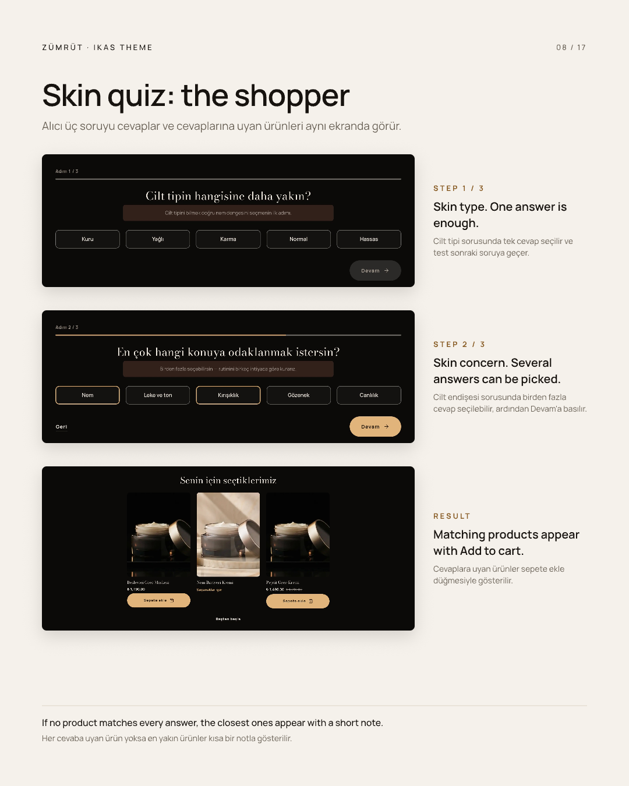

| Adım | Alıcı ne görür |
|---|---|
| 1 / 3 | Cilt tipi sorusunda tek cevap seçilir ve test sonraki soruya geçer. |
| 2 / 3 | Cilt endişesi sorusunda birden fazla cevap seçilebilir, ardından Devam'a basılır. |
| Sonuç | Cevaplara uyan ürünler sepete ekle düğmesiyle gösterilir. |

Her cevaba uyan ürün yoksa en yakın ürünler kısa bir notla gösterilir. Teste ana menüden, ana sayfadaki bantla ve kategori sayfasındaki tanıtım kartından ulaşılır.
*If nothing matches every answer, the closest products appear with a note.*

### Nasıl kurulur · Setup

Her **soru** paneldeki bir **özel alana**, her **cevap** o alanın bir **değerine** karşılık gelir.
*Each question is a custom field; each answer is one of its values.*

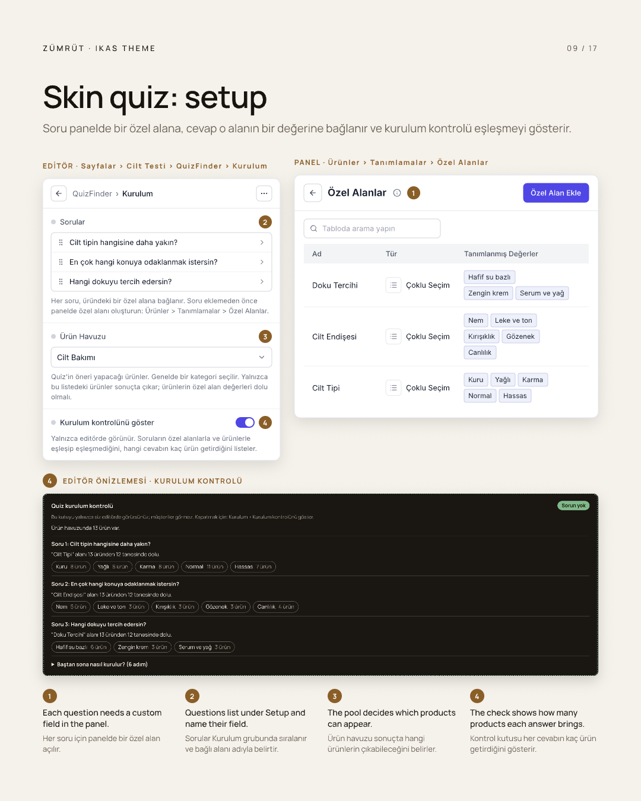

| # | Nerede | Ne yapılır |
|---|---|---|
| 1 | **Panel:** `Ürünler › Tanımlamalar › Özel Alanlar` | Her soru için bir özel alan açılır. |
| 2 | **Editör:** `Cilt Testi › QuizFinder › Kurulum › Sorular` | Sorular sıralanır ve her soru bağlı alanı adıyla belirtir. |
| 3 | **Editör:** `Kurulum › Ürün Havuzu` | Sonuçta hangi ürünlerin çıkabileceği seçilir. |
| 4 | **Editör:** `Kurulum › Kurulum kontrolünü göster` | Kontrol kutusu her cevabın kaç ürün getirdiğini gösterir. |

**Kurulum, 4 adım**

1. **Panel:** `Ürünler › Tanımlamalar › Özel Alanlar › Özel Alan Ekle`. Her soru için bir alan açın ve türünü **Çoklu Seçim** yapın (ör. `Cilt Tipi`: Kuru, Yağlı, Karma, Normal, Hassas).
2. **Panel:** Ürünlere değerleri girin. Tek tek girmek için ürünü açıp **Özel Alanlar** sekmesini kullanın. Çok ürün varsa `Ürünler › Dışa Aktar › Özel Alanlar (Ürün)` dosyasını doldurup aynı türle içe aktarın; birden fazla değeri `;` ile ayırın.
3. **Editör:** `Cilt Testi › QuizFinder › Kurulum` grubunda **Ürün Havuzu**'nu ve **Sorular**'ı doldurun.

   | Soru alanı | Ne yazılır | Örnek |
   |---|---|---|
   | Soru | Müşteriye sorulan soru | Cilt tipin hangisine daha yakın? |
   | Adım Adı | İlerleme çubuğundaki kısa ad | Cilt tipi |
   | Ürün Özel Alanı (ad) | Paneldeki özel alanın adı, birebir aynı | Cilt Tipi |
   | Çoklu Seçim | Açıksa birden fazla cevap seçilebilir | Kapalı |
   | Cevaplar › Etiket | Müşterinin kartta gördüğü yazı | Kuru |
   | Cevaplar › Eşleşme Değeri | Paneldeki değer etiketten farklıysa | Boş |

4. **Editör:** Aynı grupta **Kurulum kontrolünü göster**'i açın. Kutu yalnızca editörde görünür, müşteri görmez. "Sorun yok" yazınca kapatabilirsiniz.

*Create a multi-select custom field per question, fill product values, then set the pool and questions in the editor and use the setup check.*

---

## 11. Ritüel bulucu · Ritual finder

Ritüel bulucu tek ürün yerine üç adımlı bir gece rutini satar. Alıcı her adımda bir soruyu cevaplar, rutin yanında şekillenir ve tek bir düğme üç ürünü birden sepete ekler.
*One question per step builds a night routine with a total price and one add button.*

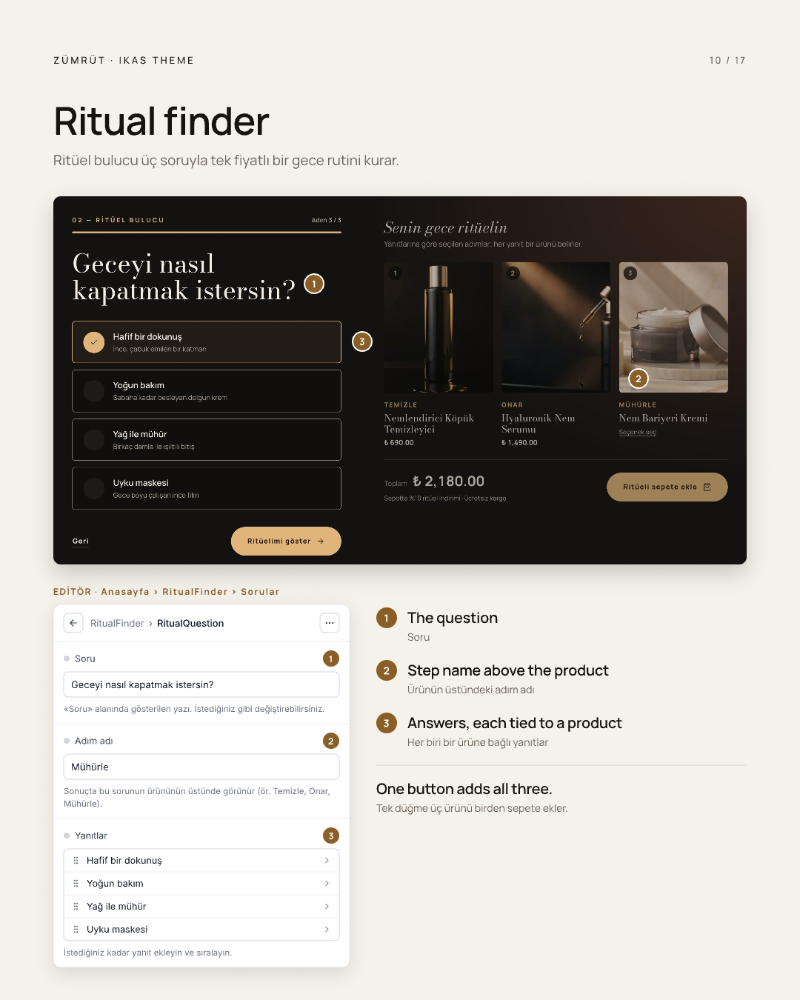

| # | Editörde (`Anasayfa › RitualFinder › Sorular › soru`) | Sitede |
|---|---|---|
| 1 | Soru | Sorunun başlığı |
| 2 | Adım adı | Ürünün üstündeki adım adı (Temizle, Onar, Mühürle) |
| 3 | Yanıtlar | Yanıt seçenekleri; her yanıtın içinde **Bu yanıtın ürünü** seçilir |

Cilt testi ürün verinizle eşleşir; ritüel bulucuda ise her cevabın hangi ürüne gittiğini siz seçersiniz. Header'daki "Ritüelini bul" düğmesi ve telefondaki orta sekme bu bölüme götürür. Telefonda sonuç alttan açılan bir panelde gösterilir.
*The quiz matches product data; in the ritual finder you pick the product behind each answer.*

---

## 12. Cilt haritası, ton bulucu, gerçek yüzler · Interactive sections

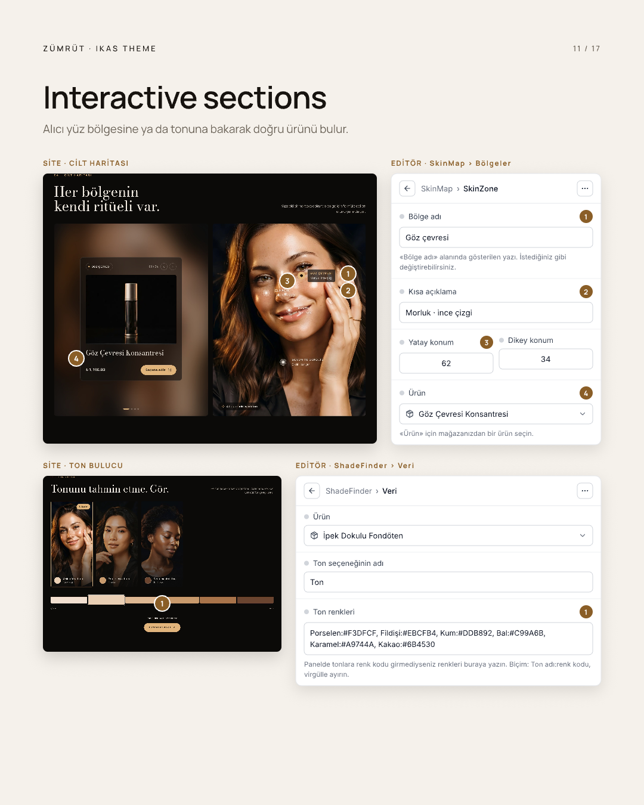

**Cilt haritası** · `Anasayfa › SkinMap › Bölgeler`

| # | Editörde (her bölge) | Sitede |
|---|---|---|
| 1 | Bölge adı | Noktanın yanındaki bölge adı |
| 2 | Kısa açıklama | Bölge adının altındaki not |
| 3 | Yatay konum / Dikey konum | Noktanın yüzdeki yeri (yüzde olarak 0–100) |
| 4 | Ürün | Bölgenin ürün kartı |

Ürün kartındaki kısa açıklama ve aktif içerikler, ürünün paneldeki özelliklerinden okunur; hangi özelliğin kullanılacağı `Bölgeler` grubunda yazılır.
*The card's description and active ingredients come from product attributes in the panel.*

**Ton bulucu** · `Anasayfa › ShadeFinder › Veri`

Bölüm, ton seçenekli bir ürünle çalışır (ör. fondöten). **Ton seçeneğinin adı** paneldeki varyant adıyla aynı olmalıdır (ör. `Ton`). Panelde tonlara renk kodu girilmediyse renkler **Ton renkleri** alanına `Ton adı:renk kodu` biçiminde yazılır (görselde 1). **Modeller** listesine her ton için bir model fotoğrafı eklenir.
*Use a product with a tone option; enter tone colors in the editor if the panel has none.*

**Gerçek yüzler** · `Anasayfa › ShoppableVideos › Videolar`

Her video kartına bir video ya da görsel, kullanıcı adı, başlık ve bir ürün eklenir. Dikey (9:16) video önerilir. Alıcı ürünü videonun üzerinden sepete ekler.
*Each card holds a vertical video, a name and a product the shopper can add from the video.*

---

## 13. Panelde girilen bilgiler · Panel to site

Bazı içerikler editörden değil, ikas panelindeki ürün ve kampanya bilgisinden gelir.
*Some content comes from the admin panel rather than the editor.*

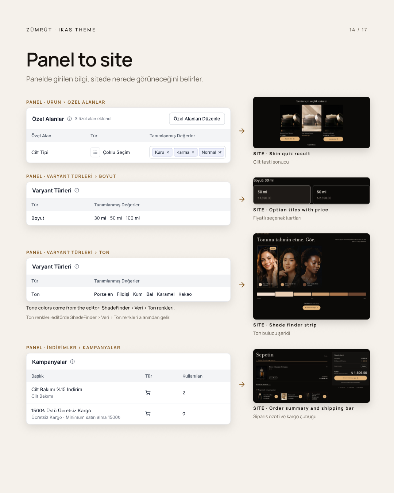

| # | Panelde | Sitede |
|---|---|---|
| 1 | `Ürün › Özel Alanlar` (ör. Cilt Tipi: Kuru, Karma, Normal) | Cilt testi sonucu |
| 2 | `Varyant Türleri › Boyut` (30 ml, 50 ml, 100 ml) | Ürün sayfasında fiyatlı seçenek kartları |
| 3 | `Varyant Türleri › Ton` (Porselen, Fildişi, Kum, Bal, Karamel, Kakao) | Ton bulucu şeridi; renkler editörde `ShadeFinder › Veri › Ton renkleri` |
| 4 | `İndirimler › Kampanyalar` (ör. Cilt Bakımı %15 İndirim, 1500₺ Üstü Ücretsiz Kargo) | Sipariş özeti satırı ve kargo çubuğu |

Bunlara ek olarak kategoriler menüyü ve cilt testinin ürün havuzunu, stok bilgisi "Tükendi" badge'ini ve "gelince haber ver" formunu, ürün grupları ürün sayfasındaki grup içi geçişi, yorumlar ürün sayfası ve ana sayfadaki yorum bölümlerini besler.
*Categories, stock, product groups and reviews also come from the panel.*

---

## 14. Renk şemaları ve tasarım sistemi · Color and design

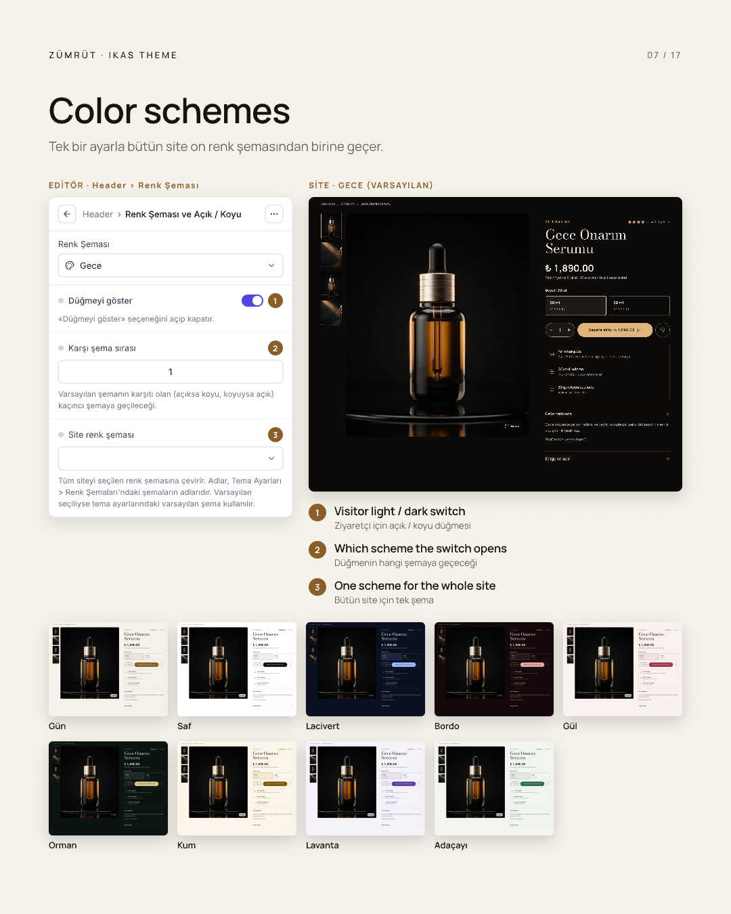

| # | Editörde (`Header › Renk Şeması ve Açık / Koyu`) | Ne yapar |
|---|---|---|
| 1 | Düğmeyi göster | Ziyaretçiye header'da açık / koyu düğmesini gösterir |
| 2 | Karşı şema sırası | Düğmenin hangi şemaya geçeceğini belirler |
| 3 | Site renk şeması | Bütün sitenin şemasını belirler |

On hazır şema vardır: Gece, Gün, Saf, Lacivert, Bordo, Gül, Orman, Kum, Lavanta, Adaçayı. Her bölümün üstündeki **Renk Şeması** seçicisiyle bir bölüme ayrı şema da verilebilir. Fotoğraf üstündeki alanlar her şemada koyu kalır, böylece yazı her zaman okunur.
*Ten schemes; each section can also use its own scheme.*

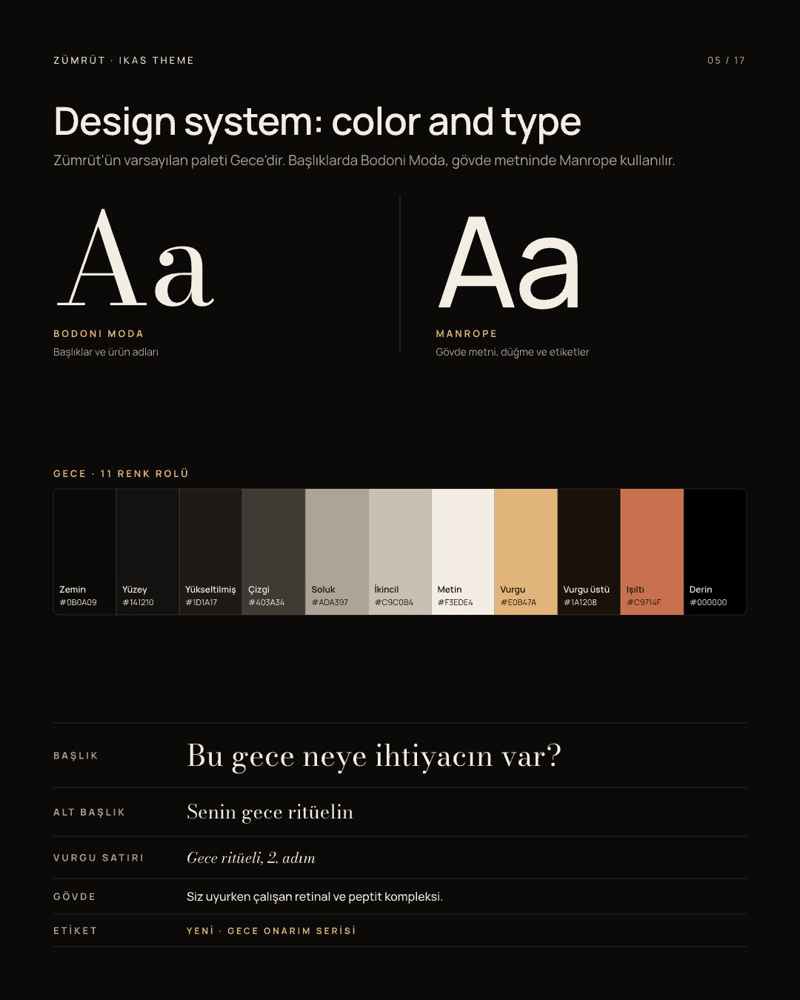
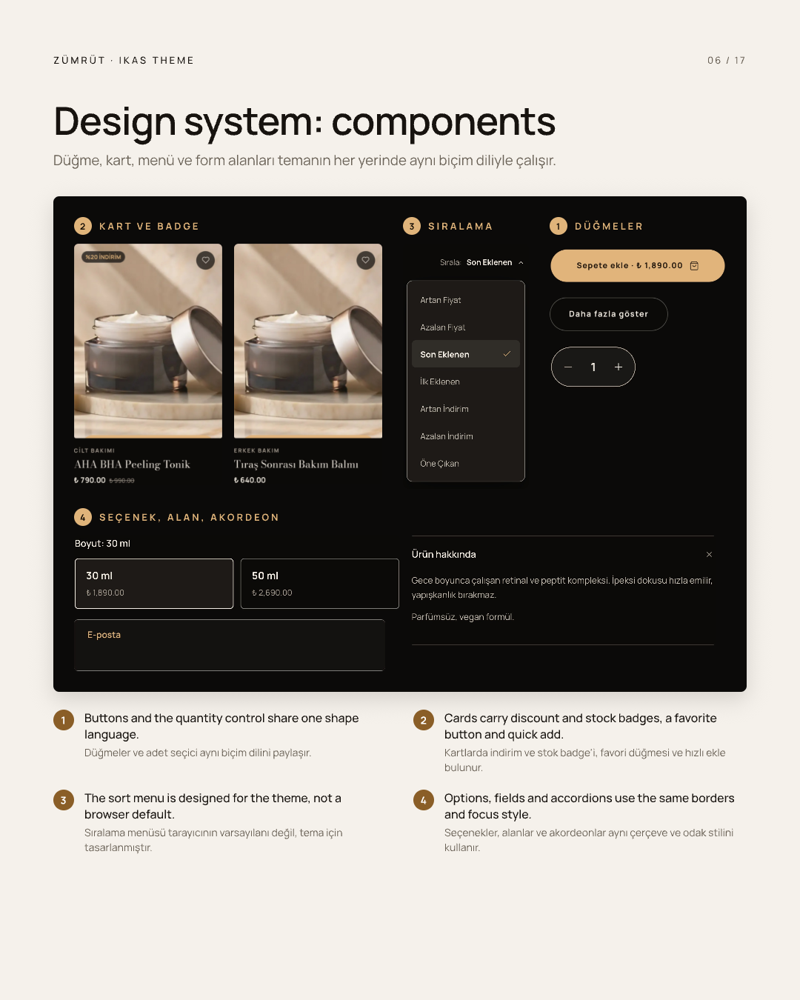

| # | Bileşen kuralı |
|---|---|
| 1 | Düğmeler ve adet seçici aynı biçim dilini paylaşır. |
| 2 | Kartlarda indirim ve stok badge'i, favori düğmesi ve hızlı ekle bulunur. |
| 3 | Sıralama menüsü tema için tasarlanmıştır. |
| 4 | Seçenekler, alanlar ve akordeonlar aynı çerçeve ve odak stilini kullanır. |

Başlıklarda Bodoni Moda, gövde metninde Manrope kullanılır. Yazı tipleri ve renkler tema ayarlarındaki global ayarlardan değiştirilir; bölümlerin **Tipografi** grubunda başlık ve üst etiketin rengi, boyutu ve yazı stili ayrıca seçilebilir. Buton köşe yuvarlaklığı `Header › Görünüm` grubundan bütün siteye uygulanır.
*Fonts and colors are global settings; each section's Typography group fine-tunes headings.*

---

## 15. Görsel oranı, kırpma ve metin konumu · Image settings

Görseli olan her bölümün **Görünüm** grubunun altında, o görselin adını taşıyan bir alt grup bulunur (ör. `Hero › Görünüm › Açılış görseli`, `Kategori sayfası › Görünüm › Ürün kartı görseli`). Burada iki ayar vardır ve ikisi de bilgisayar ve telefon için ayrı seçilir.
*Under each section's Appearance group, a sub-group named after the image holds ratio and fit, separately for desktop and phone.*

| Ayar | Ne yapar | Örnek |
|---|---|---|
| Oran (bilgisayar / telefon) | Görselin en-boy oranı | Bilgisayarda 16:9, telefonda 4:5 |
| Yerleşim (bilgisayar / telefon) | Görselin kutuyu nasıl doldurduğu (kırpma) | Kutuyu doldur ya da görselin tamamını göster |

Hero'da başlık ve butonların görsel üzerindeki yeri de `Hero › İçerik › Metin konumu (masaüstü)` ve `Metin konumu (mobil)` alanlarından ayrı ayrı seçilir.
*Hero text position is set per device too.*

---

## 16. Mobil · Mobile

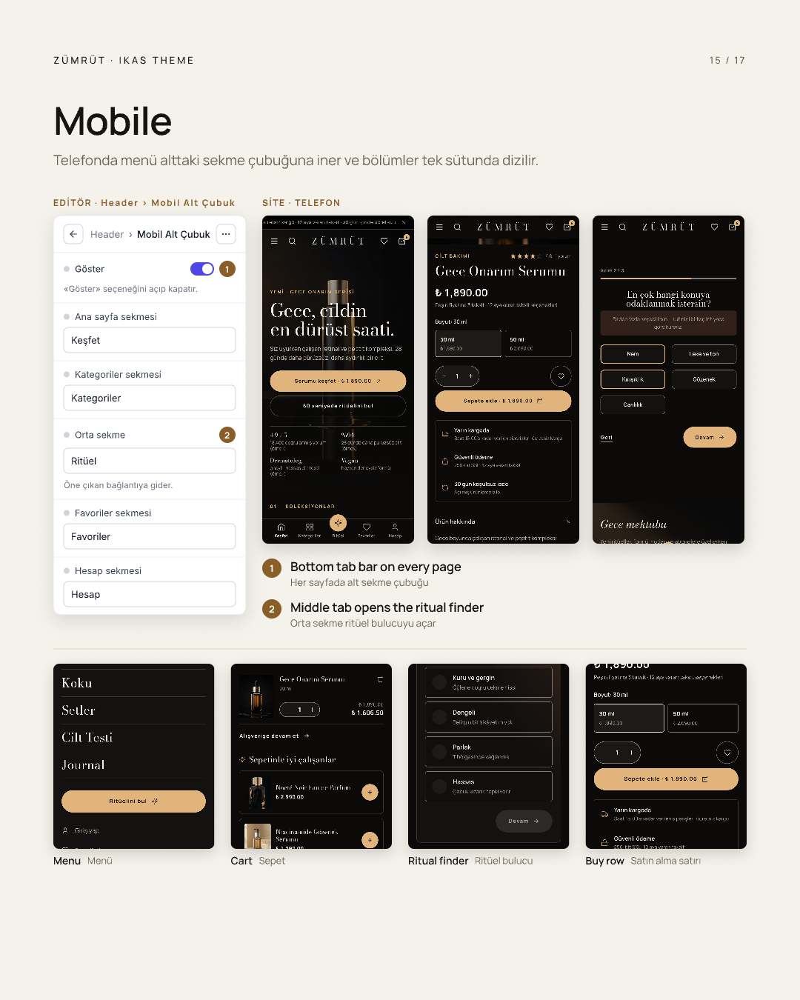

| # | Editörde (`Header › Mobil Alt Çubuk`) | Sitede |
|---|---|---|
| 1 | Göster | Her sayfada alt sekme çubuğu |
| 2 | Orta sekme | Ritüel bulucuyu açan orta sekme |

Sekme adları (Keşfet, Kategoriler, Ritüel, Favoriler, Hesap) aynı grupta değişir. Görsel oranı ve metin konumu telefon için ayrı ayarlanır (15. başlık). Form alanları iPhone'da yakınlaştırma yapmaz.
*Tab names are editable; image settings are separate for phone; forms never zoom on iPhone.*

---

## 17. Sık karşılaşılan durumlar · Troubleshooting

| Durum | Ne yapılır |
|---|---|
| Cilt testi sonuç göstermiyor ya da az ürün getiriyor. | `Kurulum › Kurulum kontrolünü göster`'i açın. Kutu, eşleşmeyen alan adlarını ve her cevabın kaç ürün getirdiğini gösterir. Sorudaki alan adı panelle birebir aynı olmalıdır. |
| Panelde özel alan değerlerini yükledim ama testte görünmüyor. | İçe aktarmadan sonra değerlerin sitede görünmesi 1–2 dakika sürebilir. |
| Ton bulucu görünmüyor. | Seçili ürünün ton seçeneği olmalı ve `Ton seçeneğinin adı` paneldeki varyant adıyla aynı olmalı. Renk kodu yoksa `Ton renkleri` alanını doldurun. |
| Ritüel bulucuda bir yanıt görünmüyor. | O yanıta bağlı ürün silinmiş olabilir. Yanıtın içinde **Bu yanıtın ürünü**'nü yeniden seçin. |
| Cilt haritasında nokta yanlış yerde. | Bölgenin **Yatay konum** ve **Dikey konum** değerlerini (yüzde) değiştirin. |
| Sepette öneriler çıkmıyor. | `CartPage › Önerilen Ürünler › Ürün listesi` boşsa bölüm gizlenir; bir liste seçin. |
| Promosyon bandında geri sayım çıkmıyor. | `PromoBanner › Geri Sayım › Bitiş tarihi` boş olabilir ya da tarih geçmiş olabilir. |
| İade talebi düğmesi görünmüyor. | Paneldeki iade ayarında siparişin durumu ve süresi iadeye uygun olmalıdır. |
| Yayınladım ama sitede eski görünüm var. | Sayfa önbelleği yaklaşık bir dakika sürer. Ayrıca ziyaretçinin açık / koyu seçimi tarayıcıda saklanır; header'daki düğmeyle değiştirilebilir. |

---

Lisans: dokümantasyon ve görseller CC BY 4.0. Tema ve kaynak dosyaları bu depoya dahil değildir. / License: documentation and images CC BY 4.0. The theme itself is not included.
